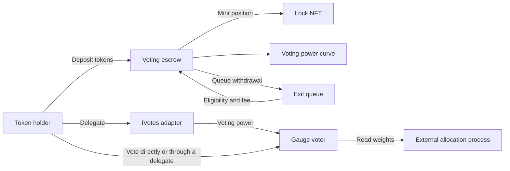

# Aragon VE Governance

Aragon VE Governance lets token holders vote on how a protocol allocates incentives or other resources. Participants lock tokens, receive a position NFT, and assign voting power to pools, projects, or other registered destinations called gauges.

VE holds the deposited tokens and tracks positions, voting power, delegation, votes, and withdrawals. Your protocol defines how votes become allocations and supplies the funds and payout mechanism. With the standard linear curve, a position gains voting power as it ages, up to a cap.

## Is VE a fit for your protocol?

VE suits protocols that want participants to influence recurring allocations and are willing to require token locking for voting power. Your team chooses the eligible gauges, voting-power curve, exit terms, and allocation rules. Some choices are contract settings; others require different implementations or additional integrations.

Your engineers will need to connect a participant interface, define and fund the allocation process, and validate the deployment. This repository provides the contracts and deployment tooling. The [integration guide](docs/integration.md) covers the application and allocation work.

Participants give up immediate access to deposited tokens: withdrawals follow the configured minimum lock age, queue wait, and fees. The DAO retains control over gauge eligibility, administrative settings, pauses, and upgrades. The supplied factory initially puts DAO administration under a multisig; gauge votes do not themselves authorize these administrative actions.

For proposal governance, the delegation adapter can supply voting power to a compatible governance plugin. Proposal execution requires that separate plugin; the gauge voter records allocation preferences.

For a new integration, start by evaluating the v1.4 configuration used in these guides. Earlier-version documentation supports maintenance and upgrades of existing deployments; Season is a separate variant. Files without a version suffix can be older implementations.

## Start here

| Goal | Read |
| --- | --- |
| Understand escrow, voting power, delegation, and exits | [How the system works](docs/architecture.md) |
| Build an application or consume gauge results | [Integration guide](docs/integration.md) |
| Install dependencies and run tests | [Local development](#local-development) |
| Configure and simulate a deployment | [Deployment guide](docs/deployment.md) |
| Identify a configuration or plan an upgrade | [Versions and upgrades](docs/versions-and-upgrades.md) |
| Review individual contract requirements | [Contract specifications](src/specs/) |
| Review audit material | [Security and reviews](#security-and-reviews) |

## What you can build

- Let participants assign voting power across registered destinations, then apply your allocation policy to the results.
- Weight governance by the escrow's voting-power curve rather than liquid token balances. The checked-in linear coefficients increase a position's power as it ages, up to a cap.
- Let holders vote through their own address or delegate to another address through the `EscrowIVotesAdapter`.
- Set a minimum lock period and withdrawal wait. The v1.4 queue supports fixed, tiered, or linearly decreasing exit fees.

The v1.4 escrow accepts an underlying token with 18 decimals and requires deposits to increase its balance by the exact amount requested. Fee-on-transfer tokens are unsupported. Review other nonstandard token behavior before integrating it.

## How it fits together

An Aragon OSx DAO manages gauges, component pauses, settings, and upgrades through its permission system. The v1.4 factory installs a multisig to administer the DAO and one VE component set per configured token.



Connect your reward distributor, emissions controller, or proposal-execution plugin separately, with the permissions it needs.

### Components in the v1.4 setup

| Component | Responsibility | Source |
| --- | --- | --- |
| Voting escrow | Holds the underlying tokens and manages each position's lifecycle | [VotingEscrowIncreasing_v1_2_0.sol](src/escrow/VotingEscrowIncreasing_v1_2_0.sol) |
| Lock NFT | Represents position ownership; restricts transfers according to its whitelist | [Lock_v1_2_0.sol](src/lock/Lock_v1_2_0.sol) |
| Voting-power curve | Calculates position and total voting power from checkpointed history | [LinearIncreasingCurve.sol](src/curve/LinearIncreasingCurve.sol) |
| Delegation adapter | Exposes current and historical voting power through an IVotes-style interface | [EscrowIVotesAdapter.sol](src/delegation/EscrowIVotesAdapter.sol) |
| Gauge voter | Records address-based weights across active gauges | [AddressGaugeVoter.sol](src/voting/AddressGaugeVoter.sol) |
| Clock | Defines epochs, checkpoints, and voting windows | [Clock_v1_2_0.sol](src/clock/Clock_v1_2_0.sol) |
| Exit queue | Records withdrawal tickets, waiting periods, and fees | [DynamicExitQueue.sol](src/queue/DynamicExitQueue.sol) |
| Plugin setup | Deploys component proxies and prepares OSx permissions | [GaugeVoterSetup_v1_4_0.sol](src/setup/GaugeVoterSetup_v1_4_0.sol) |
| Deployment factory | Creates the DAO and plugins, connects the helpers, and records their addresses | [GaugesDaoFactory_v1_4_0.sol](src/factory/GaugesDaoFactory_v1_4_0.sol) |

## Position lifecycle

1. Create a lock. Approve the escrow to spend the underlying token, then call `createLock(amount)` or `createLockFor(amount, recipient)`. The escrow holds the tokens; the recipient owns the position NFT.
2. Accumulate voting power. In the v1.4 configuration, the recorded lock start is the beginning of the current weekly checkpoint interval. Voting power is calculated from that recorded start. There is no separate warmup delay in this configuration.
3. Delegate. Call `delegate(address)` on the adapter. Self-delegation lets a holder vote through their own address. Delegation gives voting authority, not ownership of the NFT or its underlying tokens.
4. Vote. During the voting window, call `vote(GaugeVote[])` with relative weights for active gauges. A new vote replaces that address's existing allocation. Holding a lock alone does not cast a vote.
5. Use the results. An external process reads gauge weights at its chosen block and calculates allocations under its own rules. That process supplies the reward assets and payout mechanism.
6. Begin an exit. After the minimum lock requirement is met, approve the escrow to transfer the NFT and call `beginWithdrawal(tokenId)`. The NFT moves into escrow custody and its voting power is removed. The queue records a withdrawal ticket for the owner.
7. Withdraw or cancel. The ticket holder can withdraw once the ticket permits it, receiving the principal less any exit fee. The NFT is burned on withdrawal. A pending request can instead be cancelled through `cancelWithdrawalRequest(tokenId)`.

The [architecture](docs/architecture.md) and [integration guide](docs/integration.md) explain how transfers, merges, splits, and delegation affect position accounting.

### Timing and configuration

The checked-in v1.4 script uses a linear curve from approximately 1× to 2× the deposited amount over 52 two-week epochs, with integer rounding. Other deployments may use different coefficients.

The standard clock has two-week epochs and weekly checkpoints. Voting opens one hour after an epoch begins and closes one hour before the first week ends. The clock defines these windows; your protocol's separate allocation process handles payouts.

Curve coefficients and clock durations depend on the implementations you select. Some require changes to implementation code or constructor arguments. The [deployment guide](docs/deployment.md) identifies what you can set at deployment or change through the DAO.

### Gauge results and delegation

The v1.4 setup enables the voter's update hook. In this mode, allocations persist across epochs and use current delegated voting power when cast. A holder can recast during a voting window to include increased voting power. Hook-driven updates can reduce an existing allocation when voting power falls, including outside the voting window.

The same voter contract also supports a mode without that hook, using epoch-start snapshots and separate storage per epoch. Read [gauge result accounting](docs/integration.md#gauge-result-accounting) before choosing getters or building a reward snapshot.

## Local development

Install [Foundry](https://getfoundry.sh/), Git, and GNU Make. Python 3 runs the curve inspection script. Upgrade safety validation also requires Node.js and npm, which provides `npx`. Documentation generation has additional JavaScript dependencies described in the [deployment guide](docs/deployment.md#documentation-generation).

Check that `forge` is available in the shell where you run the commands. If you just installed Foundry, load your shell configuration or open a new terminal first.

For a fresh clone:

```sh
git clone --recurse-submodules https://github.com/aragon/ve-governance.git
cd ve-governance
```

For an existing clone, fetch the pinned submodules and build:

```sh
git submodule update --init --recursive
forge build
```

Run the v1.4 unit and integration suite, then inspect the configured curve:

```sh
make test-ui-140
make check-curve
```

The curve command prints coefficients and sampled voting-power values for review. Run the contract tests as well.

### Test commands

| Command | Scope |
| --- | --- |
| `make test-ui` | Unit and integration tests across configurations |
| `make test-ui-140` | v1.4 unit and integration tests |
| `make test-unit` | Unit tests across configurations |
| `make test-invariant-v1-4-0` | v1.4 invariant suite |
| `make test-upgrade-140` | Tests under the v1.4 upgrade directory; currently reuses a v1.0-to-v1.3 regression path |
| `make test-upgrade-130` | v1.3 upgrade tests, with a forced rebuild |
| `make check-curve` | Print the current curve's shape and sampled values |

The [Makefile](Makefile) has targets for other versions. Invariant suites can take much longer than unit tests; their run counts and depth are set in [foundry.toml](foundry.toml).

Fork tests need a chain RPC and matching configuration. The v1.4 fork file is commented out, so selecting it will not test a deployment. See [fork validation](docs/deployment.md#fork-validation).

## Deploying and upgrading

Start with the [deployment guide](docs/deployment.md). It covers the v1.4 script, environment variables, factory wiring, simulation, and post-deployment checks. The addresses in the example environment file are examples to verify, not a current registry of supported networks.

For an existing deployment, first identify the factory, proxy implementations, curve, clock, and permissions. Read [versions and upgrades](docs/versions-and-upgrades.md) before selecting an upgrade factory. The repository retains multiple generations of contracts, and shared source files can be used by several setup versions.

## Repository layout

| Path | Contents |
| --- | --- |
| [`src/`](src/) | Contracts, interfaces, and versioned setup and factory configurations |
| [`src/specs/`](src/specs/) | Contract-level requirements and design notes |
| [`test/`](test/) | Tests grouped by configuration, including unit, integration, upgrade, invariant, and fork tests |
| [`script/deploy/`](script/deploy/) | Version-specific deployment scripts |
| [`src/factory/upgrades/`](src/factory/upgrades/) | Upgrade factories for particular migration paths |
| [`docs/`](docs/) | Guides and Antora documentation sources |
| [`audits/`](audits/) | Audit reports, scope documents, and follow-up reviews |

Identify deployed contracts through the setup's imports and the [version map](docs/versions-and-upgrades.md). The package and Antora version fields apply to publishing.

## Security and reviews

Audit material is stored in [`audits/`](audits/), including the [initial review summary](audits/AUDIT_REPORT.md), [Halborn reports](audits/audit_halborn.pdf), [later Halborn report](audits/halborn-3.pdf), and subsequent [VE Governance updates](<audits/VE Governance Updates _ SSC.pdf>) and [Audit 4 report](<audits/VE Governance plugin - Audit 4 _ SSC.pdf>).

Check each report's scope and revision against the implementations, constants, and changes you plan to deploy. Scope notes, internal follow-ups, and material under `audits/llm/` are distinct from independent audits.

Administrative roles include upgrade authority. Review who can act through the DAO and which roles it grants. See the [architecture guide](docs/architecture.md#administration-and-permissions) for the roles and the [deployment guide](docs/deployment.md) for installation checks.
